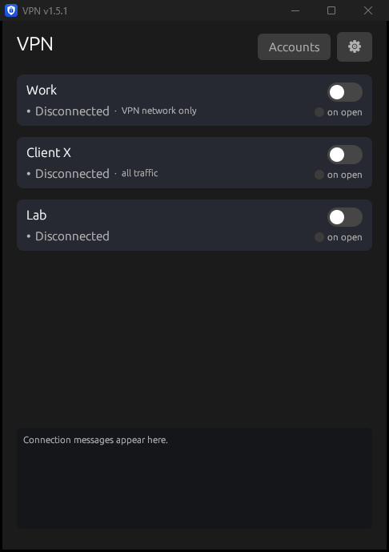
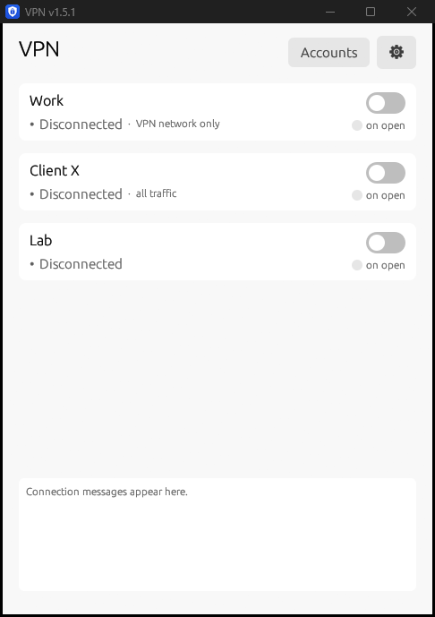
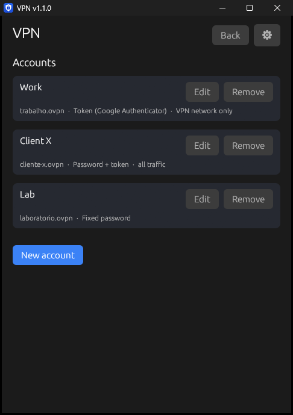
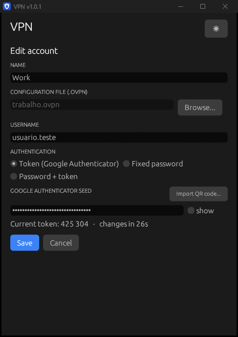
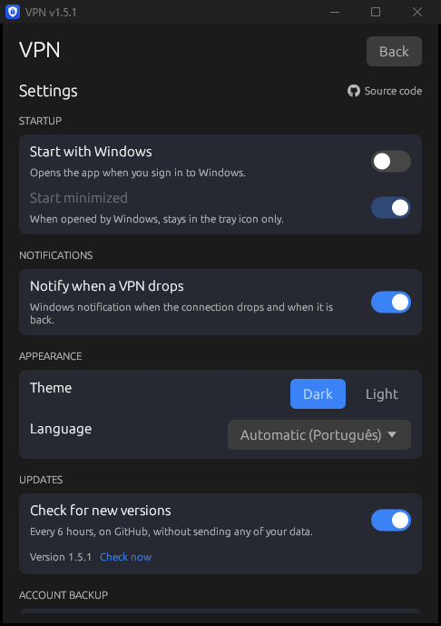
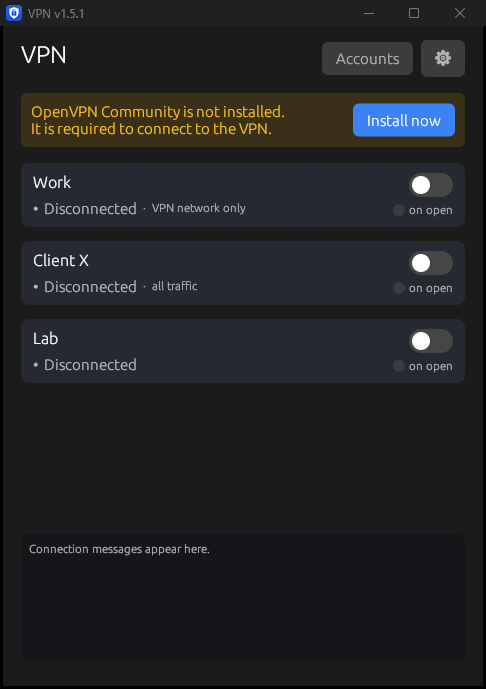
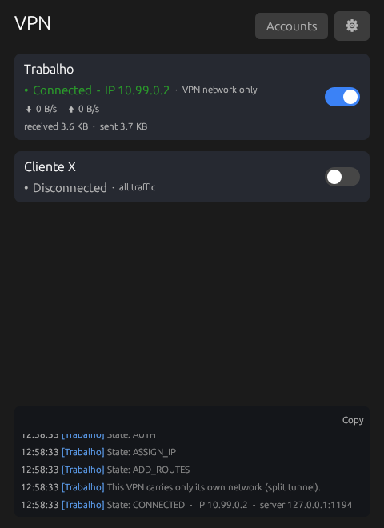
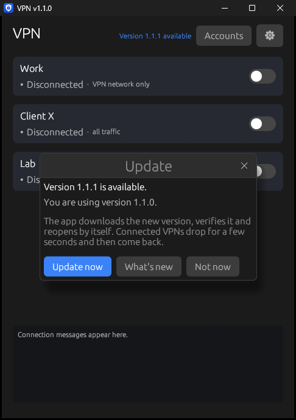

<p align="center">
  
</p>

<h1 align="center">VPN</h1>

<p align="center"><b>English</b> | <a href="README.pt-BR.md">Português</a></p>

<p align="center">
  <a href="https://github.com/Antxj/vpn/releases/latest"></a>
</p>

Windows app (and, experimentally, [Linux](#linux)) that connects to one or
**several OpenVPN VPNs at the same time**, generating the Google Authenticator token automatically — no need to
open the phone app for every connection. If a connection drops, it
reconnects by itself with a fresh token.

Written in **Rust**: a single ~12 MB native executable that already ships the
official OpenVPN installer — nothing needs to be installed beforehand.

The interface is available in English and Brazilian Portuguese, following
the Windows language (it can be set under **Settings** ⚙ › Language).

| Dark theme | Light theme |
|---|---|
|  |  |

| Accounts | Edit account | Settings |
|---|---|---|
|  |  |  |

If OpenVPN Community is not installed, the app shows a notice and installs it
silently from the embedded official installer (the check runs every 5
seconds — as soon as OpenVPN is found, the notice goes away):



## How it works

Each account has a name, an `.ovpn` file, a username and an authentication
method. When an account's toggle is switched on, the app starts a dedicated
`openvpn.exe` for it with the management interface enabled (`--management` +
`--management-query-passwords`) and answers every username/password prompt
with the account's password. When the account uses a token, it is generated
(TOTP, RFC 6238) **on every** authentication prompt — so the initial
connection, periodic renegotiations and reconnections after a drop all work
without user intervention.

- **Multiple accounts**: each with its own toggle on the home screen, status,
  IP and traffic; several can be connected at the same time
- **Log per account**: with two or more accounts in the log, discreet tabs
  show everything together ("All", each account name in its own color) or one
  account at a time. **Copy** puts the open tab on the clipboard, ready to
  send to whoever gives support — passwords, seeds, usernames and the
  computer name are hidden; one account's tab also brings the end of
  OpenVPN's own log
- **Drop notifications**: when a connection that was up stays down for 15
  seconds, a Windows notification says so, and another one when it is back
  (can be turned off under **Settings** ⚙ › Notifications; respects "do not
  disturb")
- **Four authentication methods** per account: token (Google
  Authenticator), fixed password, password + token (the password followed by
  the 6-digit code), or certificate only — picked automatically when the
  `.ovpn` file has no `auth-user-pass`, so no username is needed
- **Accounts screen**: add, edit and remove; the editor shows the
  current token so it can be compared with the phone before saving
- **System tray**: closing or minimizing does not disconnect. The icon
  summarizes all accounts (green: connected and none in transition; amber:
  some connecting or reconnecting; gray: none connected), the tooltip lists
  each connection, and the right-click menu toggles each account, plus
  "Disconnect all" and "Exit"
- **No administrator rights**: the app runs as a regular user and asks
  OpenVPN's interactive service to start each connection — the same approach
  as OpenVPN GUI. Windows only asks for administrator permission for occasional
  tasks: installing OpenVPN, authorizing a non-administrator Windows account
  once, or creating an extra network adapter (details in
  [Administrator rights](#administrator-rights))
- **Simultaneous connections**: each one needs its own virtual network
  adapter; OpenVPN 2.7 creates another one when all are in use, and the app
  falls back to OpenVPN's own `tapctl.exe` otherwise. If the fast adapter
  (DCO) is held by another OpenVPN — such as the OpenVPN Windows service —
  the app reconnects with the normal adapter by itself
- **Server not responding**: after 30 seconds without an answer from the
  server, the card shows "the server is not responding" and the log explains
  it; the app keeps trying and the notice goes away when the server answers
- **Full tunnel and split tunnel together**: each card shows whether the VPN
  carries **all traffic** (full tunnel) or **only the VPN's network** (split
  tunnel) — the app learns this on the first connection, from the routes the
  server created. One of each can be on at the same time, in any order: the
  full-tunnel VPN keeps the other VPNs' servers outside it, so they do not
  drop when it connects (details in [Routes](#routes))
- **Conflicting routes warning**: if two accounts send all traffic through
  the VPN, the app warns before connecting the second one — only the last one
  would work as the default route
- **English or Portuguese**: follows the Windows language; either one can be
  set under **Settings** ⚙ › Language
- **Settings** (⚙ button): start with Windows, start minimized in the tray,
  which accounts connect when the app opens, theme, language and update
  checks — all in one place, with the same switches as the home screen, and
  a discreet link to this source code
- **QR code import**: the same QR code used to enroll Google Authenticator
  fills in the username and seed (image file or pasted screenshot)
- **Single instance**: opening the exe again just restores the existing
  window
- **Embedded OpenVPN installer**: users without OpenVPN solve it with one
  click — the app runs the official OpenVPN Inc. MSI (redistributed
  unmodified, see [THIRD-PARTY-LICENSES.txt](THIRD-PARTY-LICENSES.txt)) in silent
  mode, installing only the core, the service and the TAP-Windows6 driver —
  deliberately **without** the OpenVPN GUI, which would add a second VPN icon
  to the tray
- Accounts (username, seed and password) are stored encrypted with **DPAPI**
  (bound to the Windows account that saved them)
- **Account backup**: **Settings** ⚙ › Account backup exports every account,
  with its `.ovpn` files, to one file protected by a password of your choice
  (Argon2id + AES-256-GCM), to take them to another computer or Windows
  account; importing it puts the `.ovpn` files back where they were or, on
  another computer, under `%APPDATA%\VPN\configs`
- **Light**: the window is drawn with OpenGL (about 40 MB in Task Manager
  with the window open). In remote desktop sessions, virtual machines and PCs
  without a video driver, where OpenGL cannot open the window, the app uses
  DirectX 12 by itself. A few seconds after going to the tray, it gives the
  window's memory back to Windows (a few MB)
- The original `.ovpn` files are used without any modification
- **Unobtrusive updates**: every 6 hours the app checks this repository's
  [Releases](../../releases); when there is a new version, a link appears at
  the top of the window, an item in the tray menu and a Windows notification
  (clicking it opens the update). "Update now"
  downloads, verifies and replaces the executable, reopens the
  app and reconnects the VPNs that were on (details in [Updates](#updates))

## Requirements

- **Windows 10 or 11**
- The `.ovpn` configuration file of each VPN
- For token accounts: the seed (the base32 key from the Google Authenticator
  enrollment — or the QR code itself)

OpenVPN Community does **not** need to be installed: the app installs it if
missing (and uses the existing installation when there is one).

The app does **not** run as administrator. Windows only asks for that
permission when OpenVPN needs to be installed, and in the other occasional
cases described in [Administrator rights](#administrator-rights).

## For users

1. Download `VPN.exe` from the [Releases](../../releases) page
2. Open it
3. If the yellow notice appears, click **Install now**, accept the Windows
   administrator prompt and wait ~1 minute
4. Under **Accounts** › **New account**, pick the `.ovpn` file, enter the
   username and authentication (or use **Import QR code…**) and save
5. On the home screen, switch the account's toggle on

On the first run, Windows SmartScreen may warn about an "unrecognized app":
click **More info** › **Run anyway**.

## Linux

> **Experimental.** The Linux version is new: it was tested on Ubuntu 24.04
> (including a real connection through a test OpenVPN server), but not yet in
> everyday use. Feedback is welcome in the [Issues](../../issues).



**Requirements**

- A desktop with GTK 3 — Ubuntu 22.04+, Debian 12+, Fedora 36+, Linux Mint,
  Pop!_OS and others (x86_64)
- OpenVPN 2.6+ and polkit, from the distribution:
  `sudo apt install openvpn` (Fedora: `sudo dnf install openvpn`)
- A tray area: Ubuntu, KDE, Xfce, Cinnamon and MATE have one; on plain GNOME
  install the *AppIndicator* extension
- Optional, for the VPN's DNS servers: `sudo apt install openvpn-systemd-resolved`

**Install**

1. Download `VPN-linux-x86_64` from the [Releases](../../releases) page
2. Make it executable and open it: `chmod +x VPN-linux-x86_64 && ./VPN-linux-x86_64`
3. Add the accounts as on Windows

On the **first connection**, the app asks for an administrator's password
**once** (polkit). That authorization installs a small helper
(`/usr/local/libexec/vpn-openvpn-helper`, a root-owned copy of the app) and
adds your account to the `vpn-openvpn` group; from then on connections need
no password — the same idea as the OpenVPN service on Windows. The helper
only accepts the options the app itself uses and refuses `.ovpn` files that
would run programs as root (`up`/`down` scripts, `plugin`, `iproute`…),
read the password from a file, or read files outside the `.ovpn` folder.
When the app ends (even if it crashes), the helper stops OpenVPN.

The accounts are saved in `~/.config/vpn/contas.dat`, encrypted with a key
kept in the desktop keyring (GNOME Keyring, KWallet). Everything else works
as on Windows: several connections at once, automatic token, tray icon,
notifications, start with the system, backup and updates.

**Uninstall**: exit the app from the tray, delete the downloaded file and
`~/.config/vpn`, then remove the authorization:

```bash
sudo rm -f /usr/local/libexec/vpn-openvpn-helper /usr/share/polkit-1/actions/io.github.antxj.vpn.policy /etc/polkit-1/rules.d/49-vpn-openvpn.rules /etc/polkit-1/localauthority/50-local.d/49-vpn-openvpn.pkla
```

```bash
sudo gpasswd -d "$USER" vpn-openvpn
```

## For developers

Requirements: [Rust](https://rustup.rs) (toolchain
`stable-x86_64-pc-windows-gnu`) and MinGW-w64 ([WinLibs](https://winlibs.com))
on the PATH — or the MSVC toolchain with Visual Studio Build Tools.

```powershell
cd rust
cargo test               # TOTP, accounts, state, adapters, QR, MSI, updates, routes, language
cargo test -- --ignored rota_direta   # creates and removes a real route (needs admin)
.\build-release.ps1      # downloads and verifies the MSI, tests and builds the release (~12 MB)
```

Before a pull request: `cargo fmt` and `cargo clippy --all-targets -- -D warnings`.
The [check workflow](.github/workflows/check.yml) runs them, and the tests,
on Windows and Linux for every pull request (Dependabot's included).
Tests never touch the everyday app's files or keyring: they use a
temporary folder of their own.

`build-release.ps1` is the **only** correct way to build a release: it
downloads the official OpenVPN installer (`rust/assets/openvpn.msi`, not in
the repository), verifies its SHA-256 and OpenVPN Inc. signature, removes
local paths from the binary and validates the result. A plain
`cargo build --release` produces an executable **without** the embedded
installer and with machine paths.

Linux: Rust, `pkg-config` and the GTK 3 development files
(`sudo apt install build-essential pkg-config libgtk-3-dev`), then
`bash rust/build-release-linux.sh` (tests, build without machine paths, checks).

Structure: the code shared by every system is in `rust/src/`; everything
that talks to the operating system is in
[`rust/src/platform/`](rust/src/platform/mod.rs), with one folder per system
(`windows/`, `linux/`) holding the **same modules with the same interface** —
the rest of the app does not know which system it runs on. A new system
(e.g. macOS) is a new folder with the same modules.

```
rust/src/
  main.rs        user interface (egui) and tray menu
  engine.rs      accounts and active connections
  vpn.rs         one connection: OpenVPN, management interface, drops
  state.rs       per-account state and log
  accounts.rs    account model, authentication, validation
  settings.rs    saved settings and accounts (contas.dat)
  backup.rs      password-protected account backup
  update.rs      checking for and installing new versions
  routes.rs      full/split tunnel, routes that keep other VPNs outside
  dialogs.rs     native dialogs (messages, questions, files)
  i18n.rs        Portuguese/English and the tr!/trf! text macros
  support.rs     "Copy" of the log, without secrets
  totp.rs        TOTP (RFC 6238)    qr.rs  QR code import
  platform/
    mod.rs       the interface every system implements
    windows/     Win32: DPAPI, OpenVPN interactive service, UAC, registry,
                 WinHTTP/WinVerifyTrust, DirectX 12 fallback, embedded MSI
    linux/       GTK tray and dialogs, keyring, pkexec/polkit helper,
                 /proc/net/route, XDG autostart, ureq
```

Modules in each `platform/<system>/`: `desktop` (window, tray icon,
notifications), `dialogs`, `installer`, `locale` (system language and local
time), `openvpn` (where OpenVPN and the configs are), `paths` (data folder),
`renderer`, `routing` (routing table), `secret` (protection of the accounts),
`service` (starting OpenVPN without administrator rights), `single` (single
instance), `startup` (start with the system) and `updater` (download and
checks of a new version); Windows also has `elevate` (UAC).

Useful variables for development and testing:

| Variable | Effect |
|---|---|
| `VPN_OPENVPN` | points to an alternative `openvpn.exe` (non-existent = forces the notice) |
| `VPN_INSTANCE` | separates a test instance from the everyday app |
| `VPN_SKIP_HINT` | does not show the first-time tray notification |
| `VPN_SCREENSHOT` | documentation screenshots: with `accounts`, `edit`, `new`, `settings`, `settings-end`, `update`, `export` or `import:<file>`, opens directly on that screen |
| `VPN_LANGUAGE` | forces `pt` or `en` (screenshots) |
| `VPN_RENDERER` | forces `opengl` or `dx12` to draw the window |
| `VPN_SEM_CHAVEIRO` | Linux: keeps the accounts key in a file instead of the desktop keyring (tests and CI) |
| `VPN_UPDATE_URL` | queries another address instead of the GitHub API (update tests) |
| `APPDATA` | redirect to a test folder so the real accounts are not touched (Linux: `XDG_CONFIG_HOME`) |

## Updates

There is no dedicated server: the app queries
`api.github.com/repos/Antxj/vpn/releases/latest` 30 seconds after opening and
then every 6 hours. That endpoint ignores pre-releases, so a version only reaches
users when it is published as final. The request sends no user data (GitHub
only sees the IP address and the app version in the User-Agent) and can be
turned off under **Settings** ⚙ › "Check for new versions".

Nothing opens by itself: when there is a new version, only the blue
"Version X available" link appears at the top of the window (plus an item in
the tray menu). The window below only opens when the user clicks it:



When the user clicks **Update now**:

1. the release's `VPN.exe` is downloaded and only accepted if it has exactly
   the SHA-256 that GitHub publishes for the asset;
2. if the running executable is digitally signed, the new one must have a
   valid signature **from the same publisher** — from the first signed
   version on, no unsigned version is ever installed;
3. the current executable is renamed to `VPN.exe.antigo` (deleted on the
   next start) and the new one takes its place;
4. the app disconnects the VPNs and closes; the new version opens by itself
   and reconnects the accounts that were connected.

## Administrator rights

Changing the network (routes, the virtual adapter address, DNS) requires
administrator rights in Windows. Instead of running as administrator, the app
asks the **OpenVPN interactive service** (`OpenVPNServiceInteractive`,
installed with OpenVPN) to start `openvpn.exe`; the service performs those
changes itself and undoes them when the connection ends. This is how OpenVPN
GUI works too.

Windows asks for administrator permission (UAC) only in these cases:

| When | Why |
|---|---|
| Installing OpenVPN (once) | the official installer changes the system |
| First connection of a Windows account that is **not** an administrator (once) | the service only lets members of the Administrators group or of the `OpenVPN Administrators` group start configs from any folder; the app offers to add the account to that group |
| All network adapters in use and OpenVPN cannot create another one (rare) | the app runs OpenVPN's `tapctl.exe` to create it |

## Routes

There are two kinds of VPN:

- **full tunnel**: all internet traffic goes through the VPN — the server
  sends `redirect-gateway` and OpenVPN creates the `0.0.0.0/1` and
  `128.0.0.0/1` routes through the VPN;
- **split tunnel**: only the company networks go through the VPN; everything
  else uses the regular internet connection.

One of each at the same time works, because Windows always uses the most
specific route. There is one catch: when the full-tunnel VPN connects, the
split-tunnel VPN's traffic **to its own server** would start going through
the other VPN, and it would drop. So a full-tunnel VPN is started with one
extra route per server of the other connected VPNs, through the local network
gateway (`--route <ip> 255.255.255.255 net_gateway`). OpenVPN itself adds
these routes (through its interactive service — the app has no administrator
rights), follows network changes on reconnect (e.g. a laptop moving to
another Wi-Fi) and removes them when it disconnects. A split-tunnel VPN
connected *after* the full-tunnel one simply goes through it. Servers with
internal addresses (10.x, 172.16–31.x, 192.168.x, 100.64–127.x) are not
excluded: they are only reachable through the local network itself or through
another VPN.

Each VPN's type is learned when it connects: the app checks whether its
adapter received the default route (or both halves `0.0.0.0/1` +
`128.0.0.0/1`). This also covers the common case where `redirect-gateway`
comes from the server rather than from the file. The result is saved in the
account, shown on the card and used by the two-full-tunnels warning. Changing
the account's `.ovpn` file clears the saved type.

Known limitation: with both connected, internal names of the split-tunnel VPN
(such as `intranet.company.local`) may stop resolving if the full-tunnel VPN
takes over DNS. If that happens, please open an issue.

## Security

- Seeds and passwords are **never** stored in plain text: only encrypted via
  DPAPI in `%APPDATA%\VPN\contas.dat`
- No password/token is written to a file — the password is sent to OpenVPN
  through the management interface, which listens only on `127.0.0.1`
- Each OpenVPN connection log is kept in `%APPDATA%\VPN\logs\` (useful for
  support); at the usual log levels (`verb` up to 4) OpenVPN does not log
  passwords or tokens
- User interface startup failures are logged in
  `%APPDATA%\VPN\startup-error.log`; the log only contains technical details
  of the graphics initialization
- `.ovpn` files are in `.gitignore` (they contain private keys) — **never**
  commit them to this repository

## Privacy

The app does not collect or send user data. Its only network connections are:

- the **VPNs configured by the user** (servers defined in each account's
  `.ovpn` file);
- the **check for new versions** on GitHub (described in
  [Updates](#updates)), which sends no user data — GitHub only sees the IP
  address and the app version — and can be turned off under **Settings** ⚙ ›
  "Check for new versions". The
  [GitHub privacy statement](https://docs.github.com/site-policy/privacy-policies/github-general-privacy-statement)
  applies.

Accounts, passwords and seeds stay on the computer only, encrypted (see
[Security](#security)).

## Uninstalling

The app has no installer. If **Start with Windows** is on, turn it off first
(**Settings** ⚙), so Windows does not keep an entry pointing to a deleted
file. Then exit the app (tray › **Exit**) and delete `VPN.exe`. To
also remove the saved accounts and logs, delete the `%APPDATA%\VPN` folder.
If OpenVPN Community was installed by the app, it can be removed under
**Windows Settings › Apps › Installed apps › OpenVPN**.

## Verifying the download

`VPN.exe` is not digitally signed yet (that is why SmartScreen may warn on
the first run). Every release is built
exclusively by the [release workflow](.github/workflows/release.yml) on
GitHub Actions, from the source code in this repository, and is reviewed
before being published.

To check that your copy is the published one, compare its SHA-256 with the one
shown next to `VPN.exe` on the [Releases](../../releases) page:

```powershell
Get-FileHash .\VPN.exe -Algorithm SHA256
```

The built-in updater does this check by itself before replacing the
executable.

Since version 1.2.0, each `VPN.exe` also carries a
[build provenance attestation](../../attestations): a proof, signed by
GitHub, of the workflow and the commit it was built from. With the
[GitHub CLI](https://cli.github.com):

```powershell
gh attestation verify .\VPN.exe --repo Antxj/vpn
```

On Linux, the same with the Linux file:

```bash
sha256sum VPN-linux-x86_64
```

```bash
gh attestation verify VPN-linux-x86_64 --repo Antxj/vpn
```

## License

[GPL-3.0-or-later](LICENSE). Third-party components (the official OpenVPN
installer, Rust libraries and fonts) and their licenses are listed in
[THIRD-PARTY-LICENSES.txt](THIRD-PARTY-LICENSES.txt).
