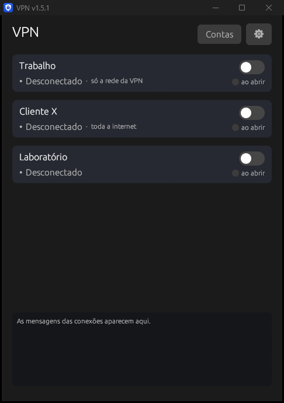
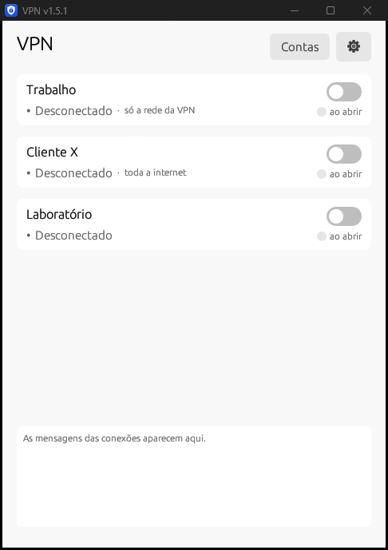
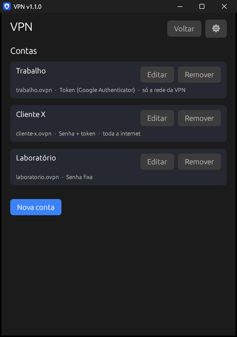
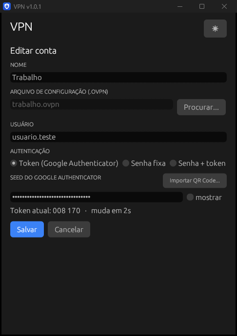
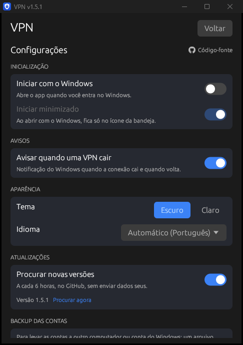
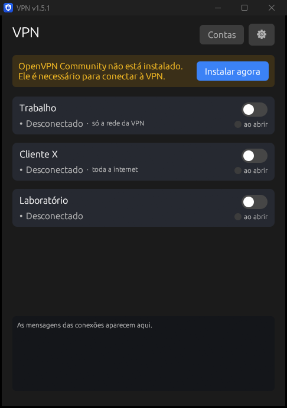
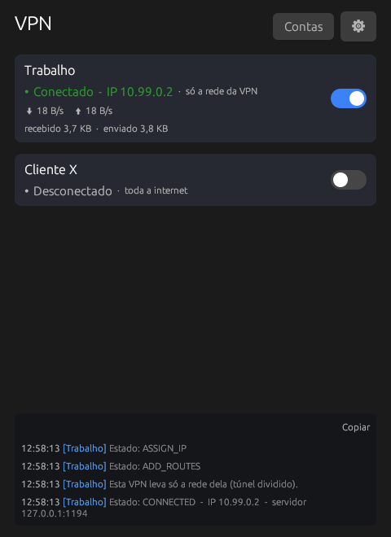
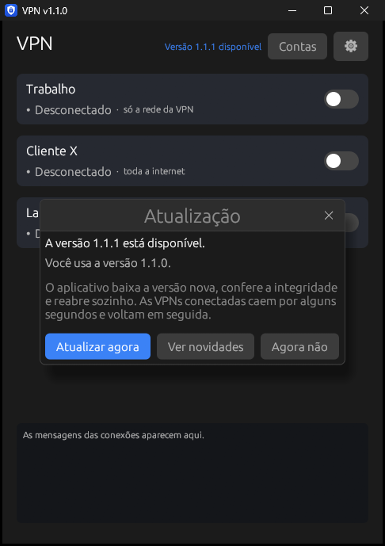

<p align="center">
  
</p>

<h1 align="center">VPN</h1>

<p align="center"><a href="README.md">English</a> | <b>Português</b></p>

<p align="center">
  <a href="https://github.com/Antxj/vpn/releases/latest"></a>
</p>

Aplicativo Windows que conecta em uma ou **várias VPNs OpenVPN ao mesmo
tempo**, gerando o token do Google Authenticator automaticamente — sem
precisar abrir o app do celular a cada conexão. Se uma conexão cair, ela
reconecta sozinha com um token novo.

Escrito em **Rust**: um único executável nativo de ~12 MB, que já traz o
instalador oficial do OpenVPN dentro — não é preciso instalar nada antes.

| Tema escuro | Tema claro |
|---|---|
|  |  |

| Contas | Editar conta | Configurações |
|---|---|---|
|  |  |  |

Se o OpenVPN Community não estiver instalado, o app avisa e instala sozinho,
em silêncio, a partir do instalador oficial embutido (a verificação roda a
cada 5 segundos — assim que o OpenVPN aparece, o aviso some):



## Como funciona

Cada conta tem nome, arquivo `.ovpn`, usuário e forma de autenticação. Ao
ligar o interruptor de uma conta, o aplicativo lança um `openvpn.exe` só para
ela, com a interface de gerenciamento habilitada (`--management` +
`--management-query-passwords`), e responde cada pedido de usuário/senha com a
senha da conta. Quando a conta usa token, ele é gerado (TOTP, RFC 6238) **a
cada** pedido de autenticação — então a conexão inicial, as renegociações
periódicas e as reconexões após queda funcionam sem intervenção.

- **Várias contas**: cada uma com seu interruptor na tela inicial, status,
  IP e tráfego; dá para conectar várias ao mesmo tempo
- **Log por conta**: com duas ou mais contas no log, abas discretas mostram
  tudo junto ("Todas", com o nome de cada conta numa cor) ou uma conta por vez.
  **Copiar** coloca a aba aberta na área de transferência, pronta para mandar
  a quem dá suporte — senhas, seeds, usuários e o nome do computador ficam
  escondidos; a aba de uma conta traz também o final do log do próprio OpenVPN
- **Aviso de queda**: quando uma conexão que estava no ar fica 15 segundos
  fora, uma notificação do Windows avisa, e outra quando ela volta (dá para
  desligar em **Configurações** ⚙ › Avisos; respeita o "não incomodar")
- **Quatro formas de autenticação** por conta: token (Google Authenticator),
  senha fixa, senha + token (a senha seguida do código de 6 dígitos) ou só
  certificado — escolhida sozinha quando o `.ovpn` não tem `auth-user-pass`,
  e aí não é preciso informar usuário
- **Tela de contas**: cadastrar, editar e remover; a edição mostra o token
  atual para conferir com o celular antes de salvar
- **Bandeja do sistema**: fechar ou minimizar não desconecta. O ícone resume
  todas as contas (verde: conectada e nenhuma em transição; âmbar: alguma
  conectando ou reconectando; cinza: nenhuma conectada), o tooltip lista cada
  conexão, e o menu do botão direito liga/desliga cada conta, além de
  "Desconectar todas" e "Sair"
- **Sem permissão de administrador**: o app roda como usuário comum e pede ao
  serviço interativo do OpenVPN que inicie cada conexão — o mesmo jeito do
  OpenVPN GUI. O Windows só pede permissão de administrador em tarefas
  ocasionais: instalar o OpenVPN, autorizar uma vez uma conta do Windows que
  não é administradora, ou criar um adaptador de rede a mais (detalhes em
  [Permissão de administrador](#permissão-de-administrador))
- **Conexões simultâneas**: cada uma precisa de um adaptador de rede virtual
  próprio; o OpenVPN 2.7 cria mais um quando todos estão em uso, e senão o
  app usa o `tapctl.exe` do próprio OpenVPN. Se o adaptador rápido (DCO)
  estiver ocupado por outro OpenVPN — como o serviço do OpenVPN do Windows —,
  o app reconecta sozinho com o adaptador normal
- **Servidor sem resposta**: depois de 30 segundos sem resposta do servidor,
  o cartão mostra "o servidor não responde" e o log explica; o app continua
  tentando e o aviso some quando o servidor responde
- **Túnel completo e túnel dividido juntos**: cada cartão mostra se a VPN
  leva **toda a internet** (túnel completo) ou **só a rede da VPN** (túnel
  dividido) — o app descobre isso na primeira conexão, pelas rotas que o
  servidor criou. Uma de cada pode ficar ligada ao mesmo tempo, em qualquer
  ordem: a VPN de túnel completo mantém os servidores das outras fora dela,
  para que elas não caiam quando ela ligar (detalhes em [Rotas](#rotas))
- **Aviso de rotas conflitantes**: se duas contas mandam toda a internet pela
  VPN, o app avisa antes de conectar a segunda — só a última funcionaria como
  rota padrão
- **Português ou inglês**: segue o idioma do sistema; dá para fixar um dos
  dois em **Configurações** ⚙ › Idioma
- **Configurações** (botão ⚙): iniciar com o Windows, iniciar minimizado na
  bandeja, quais contas conectam ao abrir o app, tema, idioma e verificação de
  atualizações — tudo num lugar só, com os mesmos interruptores da tela inicial,
  e um link discreto para este código-fonte
- **Importação por QR Code**: o mesmo QR usado para cadastrar o Google
  Authenticator preenche usuário e seed (arquivo de imagem ou print colado)
- **Instância única**: abrir o exe de novo só restaura a janela existente
- **Instalador do OpenVPN embutido**: quem não tem o OpenVPN instalado
  resolve com um clique — o app executa o MSI oficial da OpenVPN Inc.
  (redistribuído sem modificação, ver [THIRD-PARTY-LICENSES.txt](THIRD-PARTY-LICENSES.txt))
  em modo silencioso, instalando apenas o núcleo, o serviço e o driver
  TAP-Windows6 — de propósito **sem** a interface gráfica do OpenVPN, que
  colocaria um segundo ícone de VPN na bandeja
- Contas (usuário, seed e senha) ficam salvas criptografadas com **DPAPI**
  (amarradas à conta Windows de quem salvou)
- **Backup das contas**: **Configurações** ⚙ › Backup das contas exporta todas
  as contas, com os arquivos `.ovpn`, para um arquivo protegido por uma senha
  escolhida por você (Argon2id + AES-256-GCM), para levar a outro computador
  ou conta do Windows; ao importar, os `.ovpn` voltam para onde estavam ou, em
  outro computador, vão para `%APPDATA%\VPN\configs`
- **Leve**: a janela é desenhada com OpenGL (uns 40 MB no Gerenciador de
  Tarefas com a janela aberta). Em sessões de área de trabalho remota,
  máquinas virtuais e PCs sem driver de vídeo, onde o OpenGL não abre a
  janela, o app usa DirectX 12 sozinho. Alguns segundos depois de ir para a
  bandeja, ele devolve ao Windows a memória da janela (poucos MB)
- Os arquivos `.ovpn` originais são usados sem nenhuma modificação
- **Atualização discreta**: a cada 6 horas o app consulta as
  [Releases](../../releases) deste repositório; havendo versão nova, aparece
  um link no topo da janela, um item no menu da bandeja e uma notificação do
  Windows (clicar nela abre a atualização). "Atualizar agora"
  baixa, confere e troca o executável, reabre o app e reconecta as VPNs que
  estavam ligadas (detalhes em [Atualizações](#atualizações))

## Requisitos

- **Windows 10 ou 11**
- O arquivo de configuração `.ovpn` de cada VPN
- Para contas com token: a seed (a chave base32 do cadastro do Google
  Authenticator — ou o próprio QR Code recebido do suporte)

O OpenVPN Community **não** precisa estar instalado: o app instala sozinho se
faltar (e usa o que já existe na máquina, quando existe).

O aplicativo **não** roda como administrador. O Windows só pede essa permissão
quando é preciso instalar o OpenVPN e nos outros casos ocasionais descritos em
[Permissão de administrador](#permissão-de-administrador).

## Para usuários

1. Baixe o `VPN.exe` na página de [Releases](../../releases)
2. Abra o programa
3. Se aparecer o aviso amarelo, clique em **Instalar agora**, aceite a
   permissão de administrador do Windows e aguarde ~1 min
4. Em **Contas** › **Nova conta**, escolha o `.ovpn`, informe o usuário e a
   autenticação (ou use **Importar QR Code…**) e salve
5. Na tela inicial, ligue o interruptor da conta

Na primeira execução o Windows SmartScreen pode avisar sobre "aplicativo não
reconhecido": clique em **Mais informações** › **Executar assim mesmo**.

## Linux

> **Experimental.** A versão Linux é nova: foi testada no Ubuntu 24.04
> (inclusive com uma conexão real a um servidor OpenVPN de teste), mas ainda
> não no uso do dia a dia. Comentários são bem-vindos nas [Issues](../../issues).



**Requisitos**

- Um desktop com GTK 3 — Ubuntu 22.04+, Debian 12+, Fedora 36+, Linux Mint,
  Pop!_OS e outros (x86_64)
- OpenVPN 2.6+ e polkit, da própria distribuição:
  `sudo apt install openvpn` (Fedora: `sudo dnf install openvpn`)
- Uma área de bandeja: Ubuntu, KDE, Xfce, Cinnamon e MATE têm; no GNOME puro,
  instale a extensão *AppIndicator*
- Opcional, para os servidores de DNS da VPN: `sudo apt install openvpn-systemd-resolved`

**Instalação**

1. Baixe o `VPN-linux-x86_64` na página de [Releases](../../releases)
2. Torne executável e abra: `chmod +x VPN-linux-x86_64 && ./VPN-linux-x86_64`
3. Cadastre as contas como no Windows

Na **primeira conexão**, o app pede a senha de um administrador **uma única
vez** (polkit). Essa autorização instala um pequeno ajudante
(`/usr/local/libexec/vpn-openvpn-helper`, uma cópia do app que pertence ao
root) e inclui a sua conta no grupo `vpn-openvpn`; depois disso as conexões
não pedem senha — a mesma ideia do serviço do OpenVPN no Windows. O ajudante
só aceita as opções que o próprio app usa e recusa arquivos `.ovpn` que
rodariam programas como root (scripts `up`/`down`, `plugin`, `iproute`…),
leriam a senha de um arquivo ou leriam arquivos fora da pasta do `.ovpn`.
Quando o app termina (mesmo se travar), o ajudante desliga o OpenVPN.

As contas ficam em `~/.config/vpn/contas.dat`, criptografadas com uma chave
guardada no chaveiro do sistema (GNOME Keyring, KWallet). O resto funciona
como no Windows: várias conexões ao mesmo tempo, token automático, ícone na
bandeja, notificações, iniciar com o sistema, backup e atualizações.

**Desinstalação**: saia do app pela bandeja, apague o arquivo baixado e a
pasta `~/.config/vpn`, e remova a autorização:

```bash
sudo rm -f /usr/local/libexec/vpn-openvpn-helper /usr/share/polkit-1/actions/io.github.antxj.vpn.policy /etc/polkit-1/rules.d/49-vpn-openvpn.rules /etc/polkit-1/localauthority/50-local.d/49-vpn-openvpn.pkla
```

```bash
sudo gpasswd -d "$USER" vpn-openvpn
```

## Para desenvolvedores

Requisitos: [Rust](https://rustup.rs) (toolchain `stable-x86_64-pc-windows-gnu`)
e MinGW-w64 ([WinLibs](https://winlibs.com)) no PATH — ou o toolchain MSVC com
o Visual Studio Build Tools.

```powershell
cd rust
cargo test               # TOTP, contas, estado, adaptadores, QR, MSI, atualizacao, rotas, idioma
cargo test -- --ignored rota_direta   # cria e remove uma rota de verdade (precisa de admin)
.\build-release.ps1      # baixa e confere o MSI, testa e gera o release (~12 MB)
```

Antes de um pull request: `cargo fmt` e `cargo clippy --all-targets -- -D warnings`.
O [workflow de checagem](.github/workflows/check.yml) roda os dois, e os
testes, no Windows e no Linux a cada pull request (inclusive os do
Dependabot). Os testes nunca mexem nos arquivos nem no chaveiro do app do
dia a dia: usam uma pasta temporária própria.

O `build-release.ps1` é o **único** jeito correto de gerar um release: ele
baixa o instalador oficial do OpenVPN (`rust/assets/openvpn.msi`, fora do
repositório), confere SHA-256 e assinatura da OpenVPN Inc., remove os
caminhos locais do binário e valida o resultado. Um `cargo build --release`
avulso gera um executável **sem** o instalador embutido e com caminhos da
máquina.

Linux: Rust, `pkg-config` e os arquivos de desenvolvimento do GTK 3
(`sudo apt install build-essential pkg-config libgtk-3-dev`), e depois
`bash rust/build-release-linux.sh` (testes, build sem caminhos da máquina e conferências).

Estrutura: o código comum a todos os sistemas fica em `rust/src/`; tudo o
que fala com o sistema operacional fica em
[`rust/src/platform/`](rust/src/platform/mod.rs), com uma pasta por sistema
(`windows/`, `linux/`) com **os mesmos módulos e a mesma interface** — o resto
do app não sabe em que sistema está rodando. Um sistema novo (ex.: macOS) é
uma pasta nova com os mesmos módulos.

```
rust/src/
  main.rs        interface (egui) e menu da bandeja
  engine.rs      contas e conexões ativas
  vpn.rs         uma conexão: OpenVPN, interface de gerenciamento, quedas
  state.rs       estado e log de cada conta
  accounts.rs    modelo de conta, autenticação, validação
  settings.rs    configurações e contas salvas (contas.dat)
  backup.rs      backup das contas protegido por senha
  update.rs      verificação e instalação de versões novas
  routes.rs      túnel completo/dividido, rotas que mantêm outras VPNs de fora
  dialogs.rs     diálogos nativos (mensagens, perguntas, arquivos)
  i18n.rs        português/inglês e as macros de texto tr!/trf!
  support.rs     "Copiar" do log, sem segredos
  totp.rs        TOTP (RFC 6238)    qr.rs  importação por QR Code
  platform/
    mod.rs       a interface que cada sistema implementa
    windows/     Win32: DPAPI, serviço interativo do OpenVPN, UAC, registro,
                 WinHTTP/WinVerifyTrust, DirectX 12 de reserva, MSI embutido
    linux/       bandeja e diálogos GTK, chaveiro, ajudante pkexec/polkit,
                 /proc/net/route, autostart XDG, ureq
```

Módulos de cada `platform/<sistema>/`: `desktop` (janela, ícone da bandeja,
notificações), `dialogs`, `installer`, `locale` (idioma e hora local do
sistema), `openvpn` (onde ficam o OpenVPN e as configs), `paths` (pasta de
dados), `renderer`, `routing` (tabela de rotas), `secret` (proteção das
contas), `service` (iniciar o OpenVPN sem administrador), `single`
(instância única), `startup` (iniciar com o sistema) e `updater` (download e
conferências de uma versão nova); o Windows tem também o `elevate` (UAC).

Variáveis úteis para desenvolvimento e testes:

| Variável | Efeito |
|---|---|
| `VPN_OPENVPN` | aponta um `openvpn.exe` alternativo (inexistente = força o aviso) |
| `VPN_INSTANCE` | separa uma instância de teste do app de uso diário |
| `VPN_SKIP_HINT` | não mostra o aviso da primeira ida à bandeja |
| `VPN_SCREENSHOT` | capturas de tela da documentação: com `accounts`, `edit`, `new`, `settings`, `settings-end`, `update`, `export` ou `import:<arquivo>`, abre direto naquela tela |
| `VPN_LANGUAGE` | força `pt` ou `en` (capturas de tela) |
| `VPN_RENDERER` | força `opengl` ou `dx12` para desenhar a janela |
| `VPN_SEM_CHAVEIRO` | Linux: guarda a chave das contas num arquivo em vez do chaveiro do sistema (testes e CI) |
| `VPN_UPDATE_URL` | consulta outro endereço no lugar da API do GitHub (testes da atualização) |
| `APPDATA` | redirecione para uma pasta de teste para não tocar nas contas reais (Linux: `XDG_CONFIG_HOME`) |

## Atualizações

Não há servidor próprio: o app consulta
`api.github.com/repos/Antxj/vpn/releases/latest` 30 segundos depois de abrir e
depois a cada 6 horas. Esse endereço ignora pré-lançamentos, então uma versão
só chega aos usuários quando é publicada como definitiva. A consulta não envia
dados do usuário (o GitHub vê apenas o IP e a versão do app no User-Agent) e
pode ser desligada em **Configurações** ⚙ › "Procurar novas versões".

Nada abre sozinho: havendo versão nova, aparece apenas o link azul
"Versão X disponível" no topo da janela (e um item no menu da bandeja). A
janela abaixo só abre quando o usuário clica nele:



Ao clicar em **Atualizar agora**:

1. o `VPN.exe` da release é baixado e só é aceito se tiver exatamente o SHA-256
   que o GitHub publica para o anexo;
2. se o executável em uso tem assinatura digital, o novo precisa ter
   assinatura válida **do mesmo editor** — a partir da primeira versão
   assinada, nenhuma versão sem assinatura é instalada;
3. o executável atual é renomeado para `VPN.exe.antigo` (apagado na abertura
   seguinte) e o novo ocupa o lugar dele;
4. o app desconecta as VPNs, fecha, e a versão nova abre sozinha e religa as
   contas que estavam conectadas.

## Permissão de administrador

Mudar a rede (rotas, endereço do adaptador virtual, DNS) exige permissão de
administrador no Windows. Em vez de rodar como administrador, o app pede ao
**serviço interativo do OpenVPN** (`OpenVPNServiceInteractive`, instalado junto
com o OpenVPN) que inicie o `openvpn.exe`; o serviço faz essas mudanças e as
desfaz quando a conexão termina. É assim que o OpenVPN GUI também funciona.

O Windows só pede a permissão de administrador (UAC) nestes casos:

| Quando | Por quê |
|---|---|
| Instalar o OpenVPN (uma vez) | o instalador oficial altera o sistema |
| Primeira conexão de uma conta do Windows que **não** é administradora (uma vez) | o serviço só deixa membros do grupo Administradores ou do grupo `OpenVPN Administrators` iniciarem configurações de qualquer pasta; o app oferece incluir a conta nesse grupo |
| Todos os adaptadores de rede em uso e o OpenVPN sem conseguir criar outro (raro) | o app executa o `tapctl.exe` do OpenVPN para criá-lo |

## Rotas

Há dois tipos de VPN:

- **túnel completo** (*full tunnel*): toda a internet sai pela VPN — o
  servidor manda `redirect-gateway` e o OpenVPN cria as rotas `0.0.0.0/1` e
  `128.0.0.0/1` pela VPN;
- **túnel dividido** (*split tunnel*): só as redes da empresa vão pela VPN; o
  resto usa a internet normal.

Uma de cada ao mesmo tempo funciona, porque o Windows usa sempre a rota mais
específica. Há um porém: quando a de túnel completo conecta, o tráfego da de
túnel dividido **até o próprio servidor** passaria a ir por dentro da outra, e
ela cairia. Por isso, uma VPN de túnel completo é iniciada com uma rota a mais
para cada servidor das outras VPNs conectadas, pelo gateway da rede local
(`--route <ip> 255.255.255.255 net_gateway`). Quem cria essas rotas é o próprio
OpenVPN (pelo serviço interativo — o app não tem permissão de administrador),
que também as refaz se a rede mudar ao reconectar (ex.: notebook que troca de
Wi-Fi) e as remove ao desconectar. Uma VPN de túnel dividido ligada *depois* da
de túnel completo simplesmente passa por dentro dela. Servidores com endereço
interno (10.x, 172.16–31.x, 192.168.x, 100.64–127.x) não são excluídos: só são
alcançáveis pela própria rede local ou por dentro de outra VPN.

O tipo de cada VPN é descoberto ao conectar: o app olha se o adaptador dela
recebeu a rota padrão (ou as duas metades `0.0.0.0/1` + `128.0.0.0/1`). Isso
pega também o caso comum em que o `redirect-gateway` vem do servidor e não do
arquivo. O resultado fica salvo na conta, aparece no cartão e alimenta o aviso
de duas VPNs de túnel completo. Trocar o arquivo `.ovpn` da conta apaga o tipo
salvo.

Limite conhecido: com as duas ligadas, nomes internos da VPN de túnel dividido
(como `intranet.empresa.local`) podem deixar de resolver se a de túnel
completo assumir o DNS. Se isso acontecer, abra uma issue.

## Segurança

- Seeds e senhas **nunca** são gravadas em texto plano: apenas criptografadas
  via DPAPI em `%APPDATA%\VPN\contas.dat`
- Nenhuma senha/token vai para arquivo — a senha é enviada ao OpenVPN pela
  interface de gerenciamento, que escuta somente em `127.0.0.1`
- O log de cada conexão do OpenVPN fica em `%APPDATA%\VPN\logs\` (útil para o
  suporte); nos níveis de log usuais (`verb` até 4) o OpenVPN não registra
  senhas nem tokens
- Falhas ao iniciar a interface são registradas em
  `%APPDATA%\VPN\startup-error.log`; o log contém somente detalhes técnicos
  da inicialização gráfica
- Arquivos `.ovpn` estão no `.gitignore` (contêm chave privada) — **nunca**
  os commite neste repositório

## Privacidade

O app não coleta nem envia dados do usuário. As únicas conexões de rede são:

- as **VPNs configuradas pelo próprio usuário** (servidores definidos nos
  arquivos `.ovpn` de cada conta);
- a **verificação de versões novas** no GitHub (descrita em
  [Atualizações](#atualizações)), que não envia dados do usuário — o GitHub vê
  apenas o IP e a versão do app — e pode ser desligada em **Configurações** ⚙ ›
  "Procurar novas versões". Vale a
  [política de privacidade do GitHub](https://docs.github.com/site-policy/privacy-policies/github-general-privacy-statement).

Contas, senhas e seeds ficam somente no computador, criptografadas (ver
[Segurança](#segurança)).

## Desinstalação

O app não tem instalador. Se **Iniciar com o Windows** estiver ligado,
desligue antes (em **Configurações** ⚙), para o Windows não ficar com uma
entrada apontando para um arquivo apagado. Depois saia do app (bandeja ›
**Sair**) e apague o
`VPN.exe`. Para remover também as contas salvas e os logs, apague a pasta
`%APPDATA%\VPN`. Se o OpenVPN Community foi instalado pelo app, ele pode ser
removido em **Configurações do Windows › Aplicativos › Aplicativos
instalados › OpenVPN**.

## Conferir o download

O `VPN.exe` ainda não tem assinatura digital (por isso o SmartScreen pode
avisar na primeira execução). Toda
versão é gerada exclusivamente pelo [workflow de release](.github/workflows/release.yml)
no GitHub Actions, a partir do código deste repositório, e é revisada antes de
ser publicada.

Para conferir se a sua cópia é a publicada, compare o SHA-256 dela com o que
aparece ao lado do `VPN.exe` na página de [Releases](../../releases):

```powershell
Get-FileHash .\VPN.exe -Algorithm SHA256
```

A atualização pelo próprio app faz essa conferência sozinha antes de trocar o
executável.

A partir da versão 1.2.0, cada `VPN.exe` também tem um
[atestado de origem](../../attestations): uma prova, assinada pelo GitHub, de
qual workflow e de qual commit ele saiu. Com o
[GitHub CLI](https://cli.github.com):

```powershell
gh attestation verify .\VPN.exe --repo Antxj/vpn
```

No Linux, o mesmo com o arquivo do Linux:

```bash
sha256sum VPN-linux-x86_64
```

```bash
gh attestation verify VPN-linux-x86_64 --repo Antxj/vpn
```

## Licença

[GPL-3.0-or-later](LICENSE). Componentes de terceiros (o instalador oficial do
OpenVPN, bibliotecas Rust e fontes) e suas licenças estão em
[THIRD-PARTY-LICENSES.txt](THIRD-PARTY-LICENSES.txt) (em inglês).
